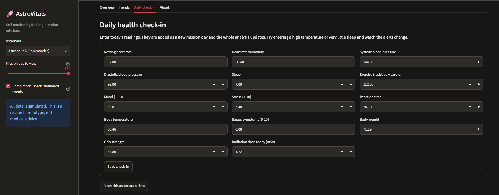
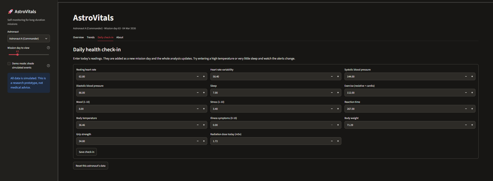
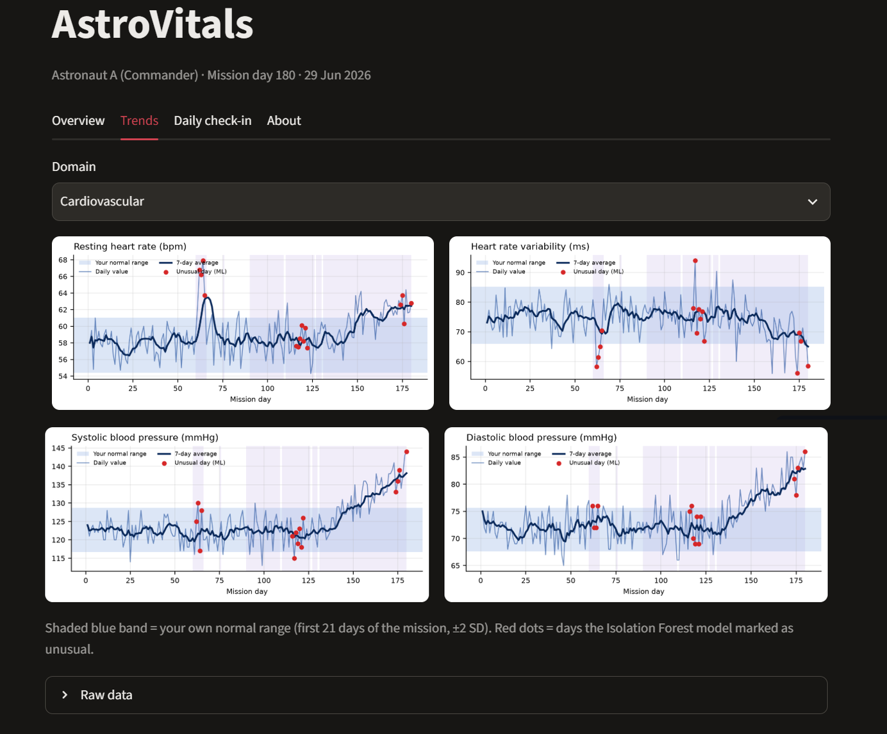
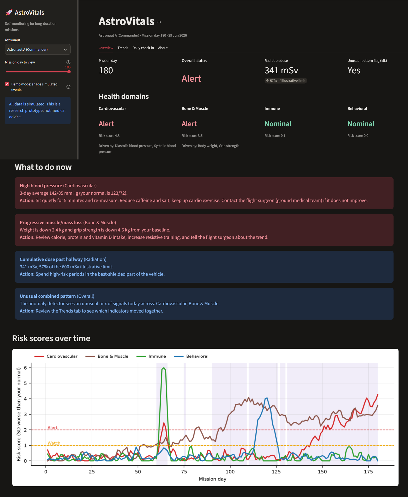

# 🚀 AstroVitals
🔗 **Live demo:** https://astrovitals-ck3p4jrfwmfsvtrp9irf7g.streamlit.app/
**Astronaut self-monitoring dashboard for long-duration missions.** Tracks cardiovascular, bone/muscle, immune and
behavioral health indicators, detects anomalies with machine learning, and recommends actions in plain language.

Built with Python, Pandas, NumPy, Scikit-learn and Streamlit for the **NASA Space Apps Challenge 2026**.

> ⚠️ All data is **simulated**. AstroVitals is a research prototype and **not medical advice**.

## The problem

Long-duration missions expose astronauts to space radiation, isolation and confinement, altered gravity and a closed
environment. These can cause immune changes, bone and muscle loss, cardiovascular events and behavioral health
problems. On missions far from Earth, communication delays mean astronauts carry much of the responsibility for
spotting these changes in themselves.

## Our solution





AstroVitals gives an astronaut a single place to check in daily and understand their health:

| Feature | What it does |
|---|---|
| **Personal baseline** | Compares each astronaut with their *own* first 21 days, not a population average |
| **Four domain risk scores** | Cardiovascular, Bone & Muscle, Immune, Behavioral, each Nominal / Watch / Alert |
| **Machine learning** | An Isolation Forest flags days with an unusual *combined* pattern across all indicators |
| **Actionable guidance** | Every alert says what we see, and what to do now, including when to contact the flight surgeon |
| **Radiation tracking** | Cumulative dose and spike detection (for example a solar particle event) |
| **Daily check-in** | Enter today's readings and the analysis updates instantly |
| **Mission replay** | Slide through mission days to watch problems develop; the model only uses data up to the selected day |

### Indicators tracked

Resting heart rate, heart rate variability, systolic and diastolic blood pressure, sleep, exercise minutes, body
weight, grip strength, body temperature, illness symptoms, mood, stress, reaction time and radiation dose.

## How it works

```
simulate.py  ->  baseline.py  ->  anomaly.py  ->  recommend.py  ->  app.py (Streamlit)
 mission data    personal normal   z-scores,        rules -> plain     dashboard
                                   risk scores,     language actions
                                   Isolation Forest
```

1. **Baseline:** mean and standard deviation of every indicator over the first 21 days.
2. **Z-scores:** how many standard deviations each reading is *worse* than normal (direction-aware: lower sleep
   is worse, higher blood pressure is worse).
3. **Domain risk score:** average worsening z-score of a domain's indicators, smoothed over 3 days.
   Watch ≥ 1, Alert ≥ 2.
4. **Isolation Forest** (scikit-learn) on all indicators together to find unusual days.
5. **Rules** turn flags into recommended actions.

## Data

Real astronaut medical data is restricted, so we generate a **simulated 180-day mission** for three astronauts, each
with different personal baselines. The trends are modeled on publicly described findings from the NASA Human Research
Program (cardiovascular change, bone and muscle loss, immune dysregulation, behavioral health, radiation exposure).
We inject known events (an infection, a solar particle event, an exercise slump, a stress period and a blood-pressure
drift) so we can **test** that the detector finds them. Turn on *Demo mode* in the sidebar to see them shaded.

The system could be connected to real wearable or on-board sensor data in future.

- NASA Human Research Program: https://www.nasa.gov/hrp/
- NASA Open Science Data Repository: https://osdr.nasa.gov/

## Run it locally

```bash
git clone https://github.com/Qasim14Khan/AstroVitals.git
cd astrovitals
python -m venv .venv
# Windows:  .venv\Scripts\activate        Mac/Linux:  source .venv/bin/activate
pip install -r requirements.txt
streamlit run app.py
```

The app opens at http://localhost:8501.

Run the tests:

```bash
pip install pytest
pytest
```

## Project structure

```
astrovitals/
├── app.py              # Streamlit dashboard
├── src/
│   ├── indicators.py   # indicators, domains, thresholds
│   ├── simulate.py     # synthetic mission data
│   ├── baseline.py     # personal baselines and z-scores
│   ├── anomaly.py      # risk scores + Isolation Forest
│   ├── recommend.py    # alerts and recommended actions
│   └── charts.py       # matplotlib charts
├── tests/              # pytest tests
├── requirements.txt
└── README.md
```

## Limitations and future work

- Simulated data and illustrative thresholds. Not clinically validated.
- The Isolation Forest is unsupervised and trained on each astronaut's own history, so it works best after the first
  month of data.
- Future work: connect wearables and on-board sensors, add lab markers (immune cells, bone biomarkers), work offline on
  the spacecraft, add crew-level view for the flight surgeon, and validate with domain experts.

## Use of AI tools

Parts of this project's code and documentation were written with help from Claude (Anthropic) and reviewed and
tested by the team.

## Team

Vector Orbit (Muhammad Qasim Khan) · NASA Space Apps Challenge 2026